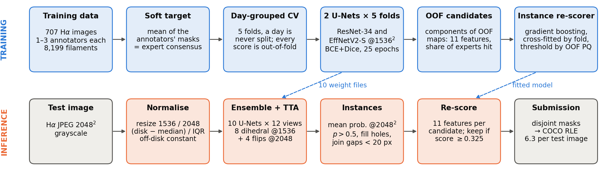

# Solar filament instance segmentation — Solar Filament Segmentation Challenge 2026

Our solution to the [Solar Filament Segmentation Challenge 2026](https://www.kaggle.com/competitions/filament-segmentation-2026)
(IEEE BigData Cup, MAGFiLO 1.0): every filament in a GONG H-alpha full-disk image (2048 x 2048, grayscale) becomes one
non-overlapping mask, scored with Panoptic Quality (PQ) against each expert annotation.

**Method in one line:** two U-Nets trained on the *mean of the annotators' masks* (expert consensus), 10 cross-validation
models x 12 test-time views, connected components with fragment grouping, and a gradient-boosting *instance re-scorer*
that keeps a candidate only if it is likely to count as a true positive. Details: technical report (`report/main.tex`, submitted as PDF).

| Result | PQ |
|---|---|
| Out-of-fold, all 707 training images (95% bootstrap CI) | **0.432** (0.423–0.441) |
| Public leaderboard (submission s10 = `configs/final_all.json`) | 0.38 |
| Reference: one expert scored against the other experts (296 images) | 0.340 (0.325–0.356) |



## Quickstart: reproduce the submission (no training)

```bash
git clone <this repository> filament && cd filament
python -m venv .venv && source .venv/bin/activate      # Windows: .venv\Scripts\activate   (Python 3.11-3.13)
pip install -r requirements.txt                         # exact versions; torch wheel from PyPI (CUDA)

# competition data (skip on Kaggle: the notebook finds /kaggle/input/... by itself)
kaggle competitions download -c filament-segmentation-2026 -p data
unzip -q data/filament-segmentation-2026.zip -d data   # -> data/MAGFiLO_1.0_Kaggle_2026/{train,test}
export FILAMENT_DATA=$PWD/data/MAGFiLO_1.0_Kaggle_2026  # optional, this is the default location

# run the whole pipeline: notebooks/submission.csv (180 test images, ~53 min on one Tesla T4)
pip install nbconvert                                   # or open the notebook in Jupyter / VS Code / Kaggle
jupyter nbconvert --to notebook --execute --ExecutePreprocessor.timeout=-1 \
        notebooks/filament_pipeline.ipynb --output filament_pipeline_run.ipynb
```

* Same thing without Jupyter: `python tools/run_pipeline.py --out submission.csv` (identical code path,
  `filseg.pipeline.Pipeline`; it also checks unique ids, non-empty masks and no overlaps).
* Quick smoke test: `MAX_IMAGES=2` for the notebook, or `--max_images 2` for the script.
* Weights are in the repository (`weights/`, 10 x 45–49 MB, fp16) and are loaded by the notebook; nothing is downloaded
  or retrained. A GPU is strongly recommended: 17.8 s per image on a Tesla T4 (10 models x 12 views each).

**Checked in a clean environment** (11-nov-2026, Kaggle kernel, fresh virtualenv with exactly `requirements.txt`,
Python 3.13.16, torch 2.15.0, Tesla T4): the notebook ran end to end with its default configuration on every 5th test
image (36 of 180). It produced the same number of filaments as our submitted file on every image (201 = 201), and every
filament matched its submitted counterpart with IoU >= 0.998 (176 of 201 masks bit-identical; the rest differ by
boundary pixels because of fp16 GPU arithmetic). The kernel script is `kaggle/clean_check/run.py`.

### Every submitted variant is reproducible

Select a configuration with `FILAMENT_CONFIG=configs/<file>.json` (notebook) or `--config` (script).

| Configuration | Kaggle submission | Ensemble and selection | OOF PQ | Public LB |
|---|---|---|---|---|
| `configs/final_all.json` (**default**) | s10 | 10 models x (8 dihedral views at 1536 + 4 flips at 2048), re-scorer >= 0.325 | 0.432 | 0.38 |
| `configs/final_ms.json` | s09 | 10 models x (4 flips at 1536 + 4 flips at 2048), re-scorer >= 0.375 | 0.431 | 0.37 |
| `configs/final.json` | s06 | 10 models x 4 flips at 1536, re-scorer >= 0.35 (about 4x less computation) | 0.427 | 0.37 |
| `configs/final_strict.json` | s08 | as s06, stricter re-scorer >= 0.45 | 0.421 | 0.36 |
| `configs/final_b.json` | s07 | as s06, fixed rule (area >= 500 px and peak >= 0.9) instead of the re-scorer | 0.416 | 0.35 |

## Method

1. **Pre-processing** (`filseg.model`): grayscale JPEG resized with area interpolation; the solar disk (pixels > 20) is
   standardised with its median and IQR/1.349, off-disk pixels set to a constant. This removes most differences between
   the six GONG sites (out-of-fold PQ per site: 0.425–0.442).
2. **Target**: every annotator's polygons rasterised with pycocotools, merged per annotator and **averaged over the
   annotators** of the image: a soft label that encodes expert agreement.
3. **Networks** (`kaggle/used_runs/`): U-Nets (`segmentation_models_pytorch`) with ImageNet encoders ResNet-34 and
   EfficientNetV2-S at 1536 px, BCE + soft Dice, AdamW 5e-4, cosine schedule, 25 epochs, batch 4, mixed precision,
   flips / rotations / scale / intensity augmentation; one model per fold of a 5-fold split grouped by observation day.
4. **Inference** (`filseg.pipeline`): each of the 10 models sees the 8 dihedral views at 1536 px and the 4 flips at the
   native 2048 px; the 120 maps are resized to 2048 px and averaged.
5. **Instances** (`filseg.postproc`): `p >= 0.5`, holes filled, 8-connected components; components less than ~20 px apart
   are grouped into one filament without adding pixels. Instances never overlap.
6. **Instance re-scorer** (`filseg.rescore`, `tools/rescore_fit.py`): 11 features per candidate (size, probability
   statistics, shape, position on the disk); a histogram gradient-boosting model, fitted on out-of-fold candidates,
   predicts the share of annotators for which the candidate is a true positive. PQ adds 1/2 to its denominator for
   every submitted instance, so a candidate helps only if P(TP) x E[IoU | TP] > PQ / 2; candidates scoring < 0.325 are
   dropped.

## Validation protocol

* 5 folds grouped by observation **day** (`configs/folds.csv`; 33 of the 180 test images share a day with a training
  image, so random splits would be optimistic). Every reported number is out-of-fold over all 707 training images
  (1,154 annotator-images).
* `src/filseg/metric.py` re-implements the organisers' PQ exactly; `tests/` checks it against a literal port of their
  self-evaluation notebook.
* The re-scorer is cross-fitted by fold (every image is scored by a model that never saw its labels) and its threshold
  is chosen on the out-of-fold PQ; choosing it per fold on the other folds gives the same PQ.
* 95% intervals bootstrap the images; ablations use paired bootstrap differences (`report/ablation.json`).

## Repository layout

| Path | What |
|---|---|
| `notebooks/filament_pipeline.ipynb` | **end-to-end pipeline**: loads the weights, predicts the test set, checks and writes `submission.csv`, scores a few training images with the exact metric |
| `src/filseg/data.py` | COCO annotations, polygon -> RLE exactly as pycocotools, RLE helpers |
| `src/filseg/model.py` | network, disk normalisation, test-time augmentation |
| `src/filseg/postproc.py` | probability map -> disjoint instances (threshold, hole filling, components, fragment grouping) |
| `src/filseg/rescore.py` | instance features and targets of the re-scorer |
| `src/filseg/metric.py` | exact Panoptic Quality of the competition (per annotator-image, IoU > 0.5) |
| `src/filseg/pipeline.py` | end-to-end inference driven by a JSON configuration |
| `src/filseg/paths.py` | data locations (environment variables, see below) |
| `configs/` | the submitted configurations (table above) and the fold of every training image |
| `weights/` | 10 U-Net weight files (fp16) and the fitted re-scorers |
| `kaggle/used_runs/` | the exact Kaggle training scripts of the released models |
| `kaggle/train_unet/run.py` | maintained version of the training script (also random-crop training) |
| `kaggle/infer_tta/run.py` | inference-only kernel that produced the extra test-time views of the OOF maps |
| `kaggle/clean_check/run.py` | the clean-environment reproducibility check described above |
| `tools/run_pipeline.py` | command-line version of the notebook |
| `tools/` (others) | ground truth, out-of-fold candidates, re-scorer fitting, submission from stored maps, report statistics and figures |
| `report/` | technical report source (`main.tex`, `main.bib`, template `preamble.tex`), figures and the statistics behind every number |
| `tests/` | metric vs. official notebook, RLE round trip, post-processing invariants (`python -m pytest`) |

Environment variables (all optional): `FILAMENT_DATA` = the `MAGFiLO_1.0_Kaggle_2026` folder (default
`data/MAGFiLO_1.0_Kaggle_2026`), `FILAMENT_GT_CSV` = ground-truth table from `tools/build_gt.py` (default
`data/gt_train.csv`), `FILAMENT_RUNS` = outputs of the training kernels (default `runs/`), `FILAMENT_CONFIG` = notebook
configuration.

## Tests

```bash
pip install pytest && python -m pytest        # 3 tests need no data; the 4th uses the training annotations if present
```

## Re-training and regenerating the report (optional)

1. **Train** (Kaggle, GPU T4 x2, competition data attached, internet on for the ImageNet weights):
   `kaggle/used_runs/run_r34_1536.py` and `run_effv2s_1536.py` with `FOLDS=0`, `1,2`, `3,4` (about 61 / 41 min per fold).
   Each run writes `model_f{k}.pth`, out-of-fold probability maps `oof/*.png`, test maps `test/f{k}/*.png` and
   `folds.csv` (a deterministic function of the observation date). `kaggle/infer_tta/run.py` adds the transposed and
   2048 px views. Put the outputs under `$FILAMENT_RUNS`.
2. `python tools/build_gt.py` writes the ground-truth table used for local scoring.
3. `python tools/candidates.py extract --probs <OOF map folders, comma separated> --thr 0.5 --group_r 10 --out cands.pkl`
   extracts every candidate with its features and its exact IoU against every annotator; `tools/candidates.py tune`
   scores fixed rules and the cross-fitted re-scorer for every threshold.
4. `python tools/rescore_fit.py --cands cands.pkl --out weights/rescorer_all.pkl` fits the released re-scorer.
5. `python tools/make_submission.py --probs <test map folders> --cfg "thr=0.5;seed_thr=0.0;min_area=0;group_r=10"
   --rescorer weights/rescorer_all.pkl --score_thr 0.325 --out submission.csv` builds a submission from stored maps.
6. Report: `tools/report_from_cands.py` (statistics, Fig. 3), `tools/ablation.py --spec report/ablation_spec.json`
   (Tables 1–2, paired bootstrap), `tools/human_agreement.py` (expert vs. expert PQ), `tools/fig_pipeline.py`,
   `tools/fig_examples.py`.

## License and acknowledgment

Code and weights: MIT (`LICENSE`). The competition data are not redistributed here.
This work utilizes GONG data obtained by the NSO Integrated Synoptic Program, managed by the National Solar Observatory,
which is operated by the Association of Universities for Research in Astronomy (AURA), Inc. under a cooperative agreement
with the National Science Foundation and with contribution from the National Oceanic and Atmospheric Administration.
The GONG network of instruments is hosted by the Big Bear Solar Observatory, High Altitude Observatory, Learmonth Solar
Observatory, Udaipur Solar Observatory, Instituto de Astrofísica de Canarias, and Cerro Tololo Interamerican Observatory.
Annotations: MAGFiLO (Ahmadzadeh et al., *Scientific Data* 11, 1031, 2024).
